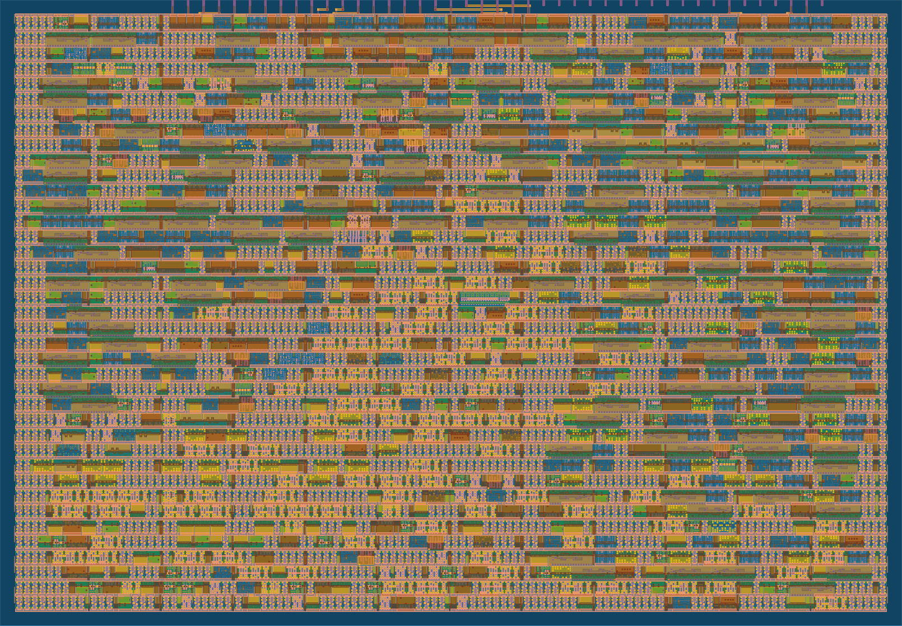

# A UART INT8 dot product accelerator in one Tiny Tapeout tile

> Newer version: [tt-int4-dot-accelerator](https://github.com/Joonsense/tt-int4-dot-accelerator), 2 INT4 MAC per clock in the same tile. [Draw a digit in the browser demo](https://joonsense.github.io/tt-int4-dot-accelerator/).

Send 16 bytes (a0, b0, ..., a7, b7) over a 115200 baud serial line, get the 20-bit saturated INT8 dot product back
as 3 bytes. Works with nothing but the Tiny Tapeout demo board's USB serial. One 1x1 tile, SkyWater sky130.
Designed and verified by the [chip-lab](https://github.com/Joonsense/tt-int4-dot-accelerator#how-it-was-made)
AI agent pipeline, hardened free on GitHub Actions. **Not fabricated.**

| | |
|---|---|
| Area | 1x1 tile, 65.5% placement utilization (Booth multiplier, formally proven equivalent to the original RTL) |
| Timing | 50 MHz, setup slack +5.14 ns at the slow corner |
| Signoff | DRC 0, LVS 0, antenna 0, precheck passed |
| Stress | 500 random vectors, 20 resets mid vector, 20 framing error recoveries; host baud tolerance -3% to +5%; gate-level 6/6 |

Want throughput instead of convenience? The parallel pin siblings in the same tile:
[tt-pin-dot-accelerator](https://github.com/Joonsense/tt-pin-dot-accelerator) (INT8, any length, about 95x this design)
and [tt-int4-dot-accelerator](https://github.com/Joonsense/tt-int4-dot-accelerator) (INT4, 2 MACs per clock).

Protocol: [docs/info.md](docs/info.md). Host client: `host/dot_client.py`.
